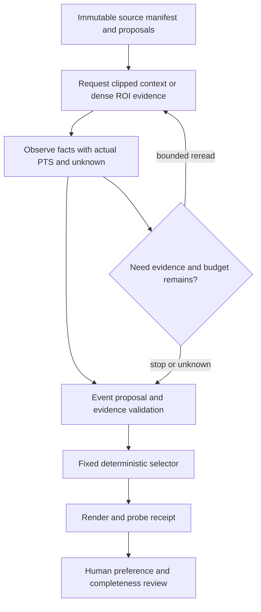

# 架構提案：單一有界 controller 與可追溯工具

查閱日：2026-10-26。狀態：未實作、未執行；下列契約不代表main現有能力或新服務已接通。

**agent的工作是找證據、決定重看與停止；事件真值、偏好與產品品質仍需獨立驗證。**
先在既有執行層用typed函式固定契約；有實際接入需求時再加MCP adapter。
不先建立多代理投票、任意工具平台或新的服務層。

## 沿用什麼、還缺什麼

既有main的[架構說明](../../architecture.md)與程式已有來源hash綁定、人工審核、coverage、預標註、剪輯及probe等部分能力。
[人工審核](../../../src/pingpong_highlight/rally_review.py)分開不可變run與人工紀錄，未檢查區間維持unknown。
這些可沿用；歷史VP／VJ／弱監督實驗的來源commit與WIP狀態見[摘要](existing-evidence.json)，不因此宣稱已合併。

現有訊號分析使用固定fps分析時間軸，GPU解碼／編碼失敗有CPU fallback。
本研究的actual source PTS、嚴格資源上限與不靜默fallback是**新增准入提案**，不能由既有功能推定已滿足。
上傳、審核權限及人工資料保護保留；研究不直接修改正式DB。

## 推薦資料流

這是有上限的循環，並非新增任務或實驗執行指令。
每個claim指向evidence IDs與actual PTS；看不到球／接觸／結果就回傳unknown或not_visible。
語言流暢、模型confidence與多次重述都不能替代獨立真值。

## 證據與狀態契約（提案）

- manifest固定source ID／SHA-256、duration、timebase、session、candidate核心時間及feature revision；標記只交evaluator。
- request固定來源區間、取樣時間、ROI座標／變換及frame／pixel上限；裁切不得改候選identity。
- observation保留requested／actual範圍、actual source PTS、frame ID／hash、重複與缺失、解碼版本及成本。
- VFR不以frame_index／nominal FPS假造PTS；插幀、重複frame及放大不能算新來源證據。
- interpretation分成statement、support IDs、可見性、unknown與model／prompt revision；不得無支撐補計數、落點或勝負。
- validator檢查schema、來源／時間／support引用、預算與可見性邊界；通過格式仍不等於語義正確。
- selection保留全母體分數、排序／tie規則、被排理由、時間計畫與plan hash；不能只留下top-k。
- artifact receipt保存operation ID、plan hash、狀態、產物hash與probe結果；人工接受另存，不由available推定。

## 五個工具的最小契約（提案）

前三項讀取來源或作受限觀察，第四項為純計畫；模型不能指定shell、任意URL、DB寫入或輸出路徑。
工具回傳結果由controller透過明示的artifact writer封存；writer只接受已准入namespace與不可變ID。
觀察工具不修改來源或人工紀錄；寫媒體只由第五項的顯式operation執行。

| 工具 | 輸入 → 輸出 | budget與failure | side effects |
| --- | --- | --- | --- |
| `read_manifest` | snapshot ID → source／session／candidate identities、hash、timebase、revision | 限定已准入snapshot與回應大小；缺hash、版本衝突、標記洩漏即拒絕 | 唯讀；不解碼、不推論、不接觸人工標記 |
| `observe_window` | source／candidate ID、start/end、時間取樣、ROI、上限 → actual PTS、frame IDs／hash、缺失與成本 | 伺服端硬限frames／pixels／wall time；越界、PTS錯、decode失敗明示error，不降規格重試 | 讀來源與暫存觀察；僅消耗已核compute，持久封存另列receipt |
| `describe_event` | evidence IDs、固定rubric與revision → statements、support IDs、unknown／not_visible、模型身份及usage | 全部model／planner calls與tokens計費；schema錯保留raw/error；unsupported不能補成成功 | 已准入模型推論；不寫人工GT、不觸發下載、不更換backend |
| `propose_selection` | 全candidate IDs、evidence-backed scores、固定selector設定 → picked IDs、理由、plan hash | 候選／分數缺失不靜默縮母體；55秒、重複、tie與邊界驗證失敗即拒絕 | 純計算，無render或DB改寫；實際selector須固定版本 |
| `render_and_verify` | immutable plan hash、operation ID、已准入artifact namespace → job handle、hash、duration、decode／A-V／來源receipt | 固定輸出大小與compute／wall上限；結果不明先查同operation，失敗不覆寫或新ID重送 | 顯式新artifact寫入；不覆寫原片、不修改人工紀錄，渲染／probe成本另列 |

每一工具都回傳`status`、`error_code`、`unknown_reason`、`consumed_budget`與receipt identity。
不將缺欄位轉成0分／false，不用成功退出碼取代完整receipt。
資料條款、模型runtime或預算未准入時，工具不可執行；本輪只有文件契約。

## 一個模型候選，保留既有baselines

| 角色 | 固定身份與官方依據 | 本研究界線 |
| --- | --- | --- |
| 既有signal／VP／VJ／weak baselines | [歷史摘要](existing-evidence.json)保留方法、seed、來源commit與結果 | 作固定對照；6/56與5/56不證明偏好，未合併程式不稱main已有 |
| 第一候選Qwen2.5-VL-7B-Instruct | [固定model card](https://huggingface.co/Qwen/Qwen2.5-VL-7B-Instruct/blob/cc594898137f460bfe9f0759e9844b3ce807cfb5/README.md)，revision `cc594898137f460bfe9f0759e9844b3ce807cfb5` | 短窗可觀測事件描述；該weight card為Apache-2.0，code／processor／decoder版本仍待pin及准入 |
| 備案Qwen3-VL-8B-Instruct | [固定model card](https://huggingface.co/Qwen/Qwen3-VL-8B-Instruct/blob/0c351dd01ed87e9c1b53cbc748cba10e6187ff3b/README.md)，revision `0c351dd01ed87e9c1b53cbc748cba10e6187ff3b` | weight card及[官方code LICENSE](https://github.com/QwenLM/Qwen3-VL/blob/main/LICENSE)各標Apache-2.0；執行code commit尚未固定，不同時大跑兩候選 |

[Qwen2.5技術報告v1](https://arxiv.org/html/2502.13923v1)§2.1說明dynamic FPS與absolute-time MRoPE。
model card的video／frame list／FPS／max_pixels接口使它適合規劃有界短窗描述；不保證逐擊球定位。
[Qwen3技術報告v1](https://arxiv.org/html/2511.21631v1)§2.3使用明確textual timestamps。
這是時間表示方式差異，不是本來源效果優劣證據。

兩者均未在本輪下載或執行；本提案配置的VRAM、吞吐、幻覺率與人工接受保持未驗證。
權重能放進顯存不代表含KV cache、視覺輸入及runtime可運行；長context宣稱不能當整場高FPS方案。
失敗不自動改量化、CPU fallback、模型版本或rubric；需要新選型時交回決策。

## 國網訓練可行性／何時值得（研究提案）

以下是本研究的工程推論，非外部paper效果宣稱；未選定國網資源、Slurm job、訓練模型或執行預算。
國網可提供compute不代表資料監督足夠，所有後續訓練均須另行確認資料、資源與執行授權。

| 路線 | input與監督 | 可回答的能力 | 准入與停止條件 |
| --- | --- | --- | --- |
| 第一輪凍結單一VLM，E0無訓練 | 固定16窗、actual PTS、三題可觀測事件與獨立人工reference | 同證據控制／同預算重看的supported收益與成本 | runtime及硬預算先准入；不可見就unknown，無有效paired收益不擴agent |
| BlurBall pretrained小樣域適配研究 | 自有小樣球XY／visibility與來源PTS；不是56個精華區間 | 球可見性／定位與域差，幫助判斷事件有無感知基礎 | data／code／weights條款通過後才取用；來源模糊不可見、domain gap或預算不可控即停，不直接宣稱精彩 |
| 固定encoder／時序features＋小temporal head | 球／玩家／事件features；有coverage的play／end／event GT，按session split | 學習play／end／event時間結構 | TemporalConv／GRU只是架構選項，尚未選型；缺event GT、跨場洩漏或只能用未標當負例就停 |
| frozen features＋小pairwise ranking head | 明示A/B比較，或同脈絡的明確喜歡／不喜歡可組成偏好pair；單獨保留正例不足以組成pair，未標維持unknown | 在事實可靠之後學個人收錄偏好 | 不把40 nonplaying當普通球偏好負例；偏好證據不足不訓練，跨場評估與成本另准入 |
| 完整7B／8B VLM fine-tune先不選 | 需要足夠問答／事件／偏好指令監督；現有資料不支持 | 尚不能據現有56精華／弱標主張可學整體影片理解 | 先補合法且相符監督及可反證目標；不因有國網GPU就選大模型訓練 |

選擇規則：fixed與adaptive都看不清，優先感知／資料；固定流程相同品質更省成本，就保留固定流程。
agent有paired且supported收益，才考慮保留bounded agent；facts可靠但不合偏好，先補最小偏好證據，不加更多agent回合。
這些分支是待決策提案，不是本輪已啟動的新階段。

## 為何值得測有界重看

[VideoAgent正式論文](https://www.ecva.net/papers/eccv_2024/papers_ECCV/papers/10325.pdf)Algorithm 1採缺失證據、檢索／觀察、更新與停止循環。
其§4評估是EgoSchema／NExT-QA問答，使用1 fps及外部GPT-4等模型，並非桌球精彩偏好。
Table 5也不支持「看更多一定更好」；只能借研究結構，不能挪用成績當本產品gain。
[官方repo](https://github.com/wxh1996/VideoAgent)的MIT badge不是本輪已核完整code准入，不能原樣執行外部API路徑。

[MotionBench v1](https://arxiv.org/html/2501.02955v1)§5.1／Table 3指出部分細動作與重複次數困難。
這支持低FPS可能漏掉高速事件的研究警覺；沒有直接測試本提案兩個Qwen或本來源，不能代為排名。
如果原片像素、模糊或遮擋已使接觸不可見，agent應停止或unknown，不能以重看承諾還原。

## MCP的接口角色與責任邊界

固定參考[MCP 2025-11-25 Tools](https://modelcontextprotocol.io/specification/2025-11-25/server/tools)、[Resources](https://modelcontextprotocol.io/specification/2025-11-25/server/resources)及[Schema](https://modelcontextprotocol.io/specification/2025-11-25/schema)。
不以latest代替固定實驗身份，也不把MCP本身當準確率提升方法。

官方事實：`structuredContent`是server-produced結果；宣告`outputSchema`時伺服器必須符合，client應驗證。
其保證結構，不保證事件判斷真實，也不等於模型生成時必受同schema約束。
Resource URI提供identity／context，不代表host或模型已讀；此版沒有專用video content block。
實際影片消費仍須decoder／host／模型契約，不能只標`video/mp4`便稱接通。

[Tasks](https://modelcontextprotocol.io/specification/2025-11-25/basic/utilities/tasks)在該版本仍experimental；需client／server協商，否則既有job handle＋status查詢足夠。
通知與TTL不能取代持久receipt；`tasks/get`只查task狀態，`tasks/result`取得底層結果。
`tasks/cancel`可標cancelled，但後續execution即使完成／失敗仍維持該狀態，因此**cancelled不是GPU／子程序已停證據**。
[一般Cancellation](https://modelcontextprotocol.io/specification/2025-11-25/basic/utilities/cancellation)也可能因完成或不可取消被忽略。

本研究的應用層提案：同`operation_id + plan_hash`去重、持久查詢receipt；結果unknown先查原operation，不能新建重送。
`cancel_requested`、`task_cancelled`、`compute_stopped`、`artifact_available`分開；停止證據由實際執行層回報。
MCP沒有替應用保證exactly-once、外部副作用回滾或應用去重；這是根據規格責任邊界的推論。
任意外部供應商或遠端影片移轉仍須另外明確授權；本輪沒有相關操作。

回到[方向結論](README.md)；[資料准入](datasets.md)與[實驗／停止條件](experiment.md)分別核對。
